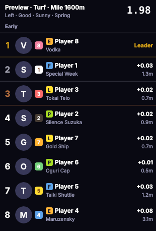
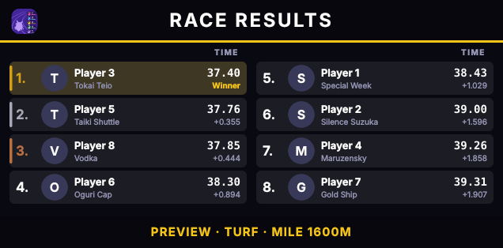
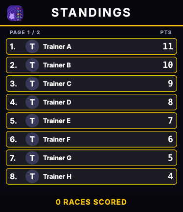
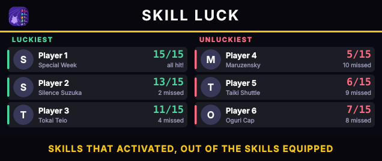
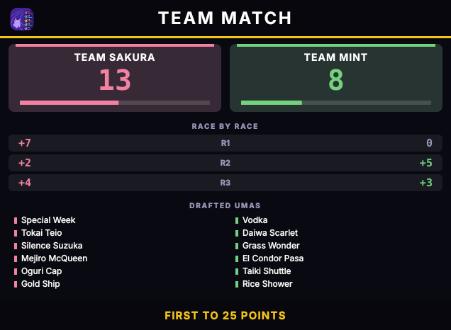

# 🏇 Umamusume Race Overlay (Windows)

**A race tower, results board, points, skill luck board and team match board for Uma Musume: Pretty Derby, made for OBS.**

> This is the **Windows** version. There is a separate **Linux** version in its own repository
> ([umamusume-race-overlay-linux](https://github.com/TakamoriSubaru/umamusume-race-overlay-linux)). The two share the same ideas but are released separately.

The overlay draws the race as normal windows that OBS captures with **Window Capture**: the tower during the race, then the results, standings, skill luck and team match boards. It reads race data from the community tool **Race Overlay** (live) or from saved race files. It never touches the game.

---

## 📥 Install

**New here? Read the [step by step guide](GUIDE.md).**

1. Open **Releases** on this page and download **`race-overlay-windows-X.Y.Z.zip`**. The server files (Race Overlay) are already inside, in the `Server Files` folder.
2. Unzip it anywhere (right click, *Extract All*; do not run it from inside the zip).
3. Start **`UmaRaceOverlay.exe`**. No Python and no installer needed.

Windows may say *Windows protected your PC* because the program is not signed. Choose **More info**, then **Run anyway**.

## ▶️ First start

A **welcome guide** asks what you want to show: *Just the tower*, *Tower and results*, *Points for every player*, *Team match (draft)* or *Everything at once*, and the tower size (full or small corner). It switches the right boards on and lists what to do next. You can change it any time in the **Home tab, Setup**. Colours, fonts, window position and folders are never changed by a setup.

1. Put the original **Race Overlay** folder (the one with `Race Overlay.exe`) in your Documents, Downloads or Desktop folder. The overlay finds it, starts its server once Uma Musume is running (and again until the server has found the game), and closes it when you quit. Somewhere else? Choose the folder in **Home tab, More**. If it is missing, the overlay keeps looking and the **Help tab** says so.
2. Start Uma Musume. The dot in the Home tab turns green when everything is ready. For saved races instead of live data, choose the folder in the **Race data** tab.
3. Press **Show preview race** to see the tower with made-up umas.

> Race Overlay is a separate community program. It is **not** included here and this project never changes or redistributes it.

## 🎥 Use it in OBS

Add a **Window Capture** source, set the *Capture Method* to **Windows 10 (1903 and up)** and pick **Umamusume Race Overlay (Windows)**. Every board is its own window, so add one source for each, for example *Umamusume Race Results (Windows)*, *Umamusume Standings (Windows)*, *Umamusume Skill Luck (Windows)* and *Umamusume Match (Windows)*. Use *Show ... board (to place it)* in the Home tab to place them before you stream.

- The window must be **shown** for OBS to capture it (*Show overlay window* in the Home tab). The choice is remembered.
- If a window is captured black or without transparency, start the program with `--chroma` (right click your shortcut, *Properties*, add ` --chroma` after the path in *Target*) and add a **Chroma Key** filter in OBS.
- A **borderless fullscreen** game hides windows that stay on top. Use *Windowed* or *Borderless windowed* in the game's graphics settings, or capture the game and the overlay as two OBS sources.

## 🔀 Where the settings live

Settings, scores and the team match are saved in `%APPDATA%\race-overlay-native`. Your pictures go in `%APPDATA%\\race-overlay-native\\images`, so an update never loses them. To share them with a friend: People tab, *Players*, **Save my pictures as a zip...** (send it privately, never on GitHub: the uma pictures are Cygames' art), and the friend uses **Import pictures zip...**. If the program crashes at start, the reason is in `crash.log` in the settings folder and in a message box.

## ⬆️ Updating

**The program updates itself.** A few seconds after it starts it looks for a new version; if there is one a window asks *Update now / Later / Skip this version*. *Update now* downloads the new files, closes the program, replaces them and starts it again (your settings and pictures are kept in `%APPDATA%`, and the `Server Files` folder is not touched). You can turn this off in the Home tab (More). If it ever fails, download the newest zip from the Releases page and unzip it over the old folder.

## 🧰 Command line options

Add them after the path in the shortcut's *Target*.

| Option | Meaning |
| --- | --- |
| `--chroma` | Solid green background for an OBS Chroma Key |
| `--transparent` | Transparent window (not every setup can capture it) |
| `--show` | Show the overlay window at start |
| `--no-tray` | No tray icon, the overlay is always shown |
| `--no-game-link` | Do not wait for or follow Uma Musume |
| `--watch FOLDER` | Saved races from this folder |
| `--demo FILE` | Replay a saved race |
| `--hold` | Keep the tower and boards until the next race |
| `--version` | Print the version |

## ⌨️ Keys and mouse

| Input | Action |
| --- | --- |
| Left mouse drag | Move the window (no title bar) |
| Drag an edge | Resize |
| Right click | Menu |
| `S` | Settings |
| `T` | Pictures: uma + player, uma only, player |
| `Esc` | Hide the overlay (it keeps running in the tray) |

The **Help tab** in the settings runs a few checks (is the game running, is Race Overlay found, is its server answering) and shows the program's log.

---
## 📂 Saved races folder

Open the **Menu** and go to the **Races** tab:

1. **Where do the races come from?** Choose *Live* (exact, from Race Overlay), *Saved races* (read the race files from a folder), or *Follow the start choice* (the default: live data when Race Overlay's server is found).
2. **Saved races folder:** press **Browse...** and choose your main folder, for example `Documents/Saved races`. Keep **Also look in the folders inside it** ticked if your files are sorted into folders such as *Career*, *Champions meeting*, *Room match* or *Team trials*.
3. The window shows how many `.json` files it found. Changing the folder works at once while the program runs. Changing the source asks you to restart.

Good to know:

- The choice made in Settings is saved in `%APPDATA%\race-overlay-native\config.json`.
- Files that are not races (for example a list of veterans) are skipped automatically.
- "Reset look to defaults" does **not** reset your folder or source.
- A race file is written when the race **loads**, not when it starts. The overlay therefore waits **Start delay** seconds (Data tab, default 12) after it sees a new file before it slides in. If it appears too early, make the delay bigger; too late, smaller. The arrow keys in the overlay window fine-tune it (0.25 s left / right, 1 s down / up). A saved file cannot tell how long you stay on the line-up screen, so this is always an estimate. **Live** mode is exact.

---

---

## 🙈 Hidden until the race, slide-in

- **Before the race there is no overlay.** The window stays hidden. When the race starts it appears (without taking the keyboard focus away from the game) and the tower slides in. After the race it slides out and the window hides again.
- **Which side?** *Look* tab → **Slides in from**: *Auto* uses the side of the screen the window is on (window on the right half: from the right), or force *left*, *right*, or *no sliding*.
- **Placing the window:** open the Menu and press **Show overlay window (to place it)**. Drag it where you want it, then press the button again. The position is remembered.
- **Old behaviour:** untick **Hide the window until a race starts** in the *Look* tab. Without a tray icon the window is always shown, because you could not get it back.
- **In OBS:** the *Window Capture* source is empty while the window is hidden and picks the window up again when it appears. For a clean slide (the tower sliding over your video and not over a dark box), start with `--chroma` and add a **Chroma Key** filter.
- **Live vs saved races:** in *live* mode the window appears exactly when the real race clock starts. With *saved races* the start is calculated, see [Saved races folder](#-saved-races-folder).

---

---

## 🏁 Results board

When the race ends the tower slides out and the results board slides in. It shows every uma in finishing order, with the finish time and the gap to the winner, and the track name at the bottom. Up to 6 umas are shown in one column, more are split into two columns. The window sizes itself to the number of umas; pull its edges to make it bigger or smaller and the size is remembered.

- It is a separate window called **Umamusume Race Results (Windows)**, so you can place it anywhere on the stream, independent of the tower.
- **Look tab, Boards:** turn it on or off, choose how long it stays (or *Until the next race*), give it your own **title** (for example *GRAND FINAL*), and choose what each row shows: finish time and gap, time only, or names only. `--hold` keeps it until the next race too.
- It uses the same colours, font, picture choice (uma / player / both) and slide direction as the tower. The *Accent colour* is the title line and the track name.
- **Home tab / tray menu:** *Show results board (to place it)* shows it with sample places, so you can position and style it before any race has been run.
- Equal finish times share one place. A uma without a finish time shows `--`.
- `Esc` or right click, *Hide the results board*, closes it early.

---

**When the boards come in:** in the Look tab, Boards, *When the boards come in*. After a race the results board comes in first. The skill luck, match and standings boards each come in either *After the one before* (one at a time, the default) or *Together with the results*, so all boards are on screen at once. Each has extra seconds of waiting time, and *Show all at once* sets them all together. Put every board in its own place in OBS.

---

## 🏆 Points and standings

After every race each trainer gets points, like stage points in NASCAR: **1st gets as many points as there are players, the last gets 1** (10 players: 10, 9, 8 ... 1; players that tie get the same points; the standings list is numbered 1, 2, 3 ... without repeats). The results board shows them in a **PTS** column, and the **standings board** (its own window: **Umamusume Standings (Windows)**) comes in afterwards and stays until the next race starts. With more players than fit on one page it flips through everybody.

In the **Standings** tab you choose where the numbers come from:

- **Counted by this program:** every race you play with it is scored and saved (`scores.json` in the settings folder). *Undo last race*, *Save as .csv* and *New bracket* are there too. Preview races, replays and old race files never give points, and the same race is never counted twice. Players are matched by trainer name.
- **A spreadsheet:** paste a Google Sheets link (Share -> *Anyone with the link* -> Viewer; the link of the tab you want picks that tab) or choose a `.csv` / `.xlsx` file. Set the columns (player, points, optional uma) and the first row. It is reloaded every minute and only read, never changed.

**Rounds:** in the Cup Score tab (Rounds section) choose *Round 1*, *Round 2*, *Round 3*, *After Round 2* (rounds 1 + 2) or *Overall Total* (all three). Everything is read from the same sheet tab. The tables are found **automatically by their headers** (*Trainer / Uma / Score* for each round, *Member / Round 1 / Round 2 / Round 3* for the final table), so it also works when Google leaves hidden columns out of the download. You can type the columns by hand instead (for example `B,C,D; G,H,I; L,M,N` and `Q,R,S,T`). While streaming, switch with a right click on the standings board or in the tray menu (*Standings view*). Players with 0 points are not shown (can be turned off).

**Borders:** in a single round, players with **9 points get a gold border, 8 silver and 7 bronze** (the three numbers can be changed). When rounds are added up, the **best N players** (default 10, changeable) get a gold border.

**Look and timing:** every player gets an **avatar** (the picture from the People tab (Players), else the first letter). *Shape* switches between **portrait** (one column) and **landscape** (two columns). *Show it after every N races* (for example 5) decides when the standings come in by themselves; *never* means only when you press *Show / hide the standings now* (Cup Score tab or tray menu).

Use *Show standings board (to place it)* in the Menu to put the window where you want it on the stream.

---

## 🍀 Skill luck board

After the results board, an optional **skill luck board** shows the **luckiest** and the **unluckiest** players of the race: how many of the skills a player brought actually activated (for example 13/16), who missed the most, and who hit every skill. In OBS it is its own window: **Umamusume Skill Luck (Windows)**.

Turn it on in the Look tab, Boards (*Skill luck board*), choose how many players are listed on each side, how long it stays, and give it your own title. *Show skill luck board (to place it)* in the Home tab or tray menu shows sample data so you can place it first. It needs the list of equipped skills, which **saved race files** contain. Without it the board counts only the skills that activated. The numbers come from the race data the game already wrote, nothing is read from the game.

---

## 🤝 Team match (draft)

For team events (3v3, 5v5, 6v6, 7v7 ...) the **Draft tab** keeps the score of the match for you. Two teams, a few players each:

- **First team to reach 25 wins** (changeable). After each race the best placed **team players** score for their team: **1st 4 points, 2nd 2, 3rd 1** (changeable, for example `5,3,1`).
- Players that are on **no team** (NPCs, other players) never score. The next team player simply takes the placement, as in the usual rules.
- Type the **trainer names** of each team (one per line, capital letters do not matter) or use *Add a player seen in a race...*. Optionally list the **drafted umas** of each team.
- The **match board** (its own window: **Umamusume Match (Windows)**) comes in after the results board and stays until the next race: both scores with a progress bar, the points of every race, the drafted umas, and *TEAM X WINS!* when a team reaches the target. Use *Show match board (to place it)* in the Home tab to position it first.
- On the results board the rows are tinted in the team colour and the **PTS** column shows the team points of the race.
- A ruling (a remake, a penalty, a disconnect): **Add or take points...**. A wrong race: **Undo last race**. **New match** forgets the races and keeps the teams.
- While *Team match mode* is on, the single-player points and the standings board pause. Replays, previews and old race files never score, and the same race is never counted twice.

---

## 🗺️ Not tested yet

This version was written on Linux and checked there with a headless test (the GitHub build repeats it on a Windows machine), but it has **not been tried on a real PC with the real game and OBS yet**. Things to watch: the saved-races folder (where the game's race files are written on Windows), OBS capture of the transparent windows, and starting Race Overlay's server. Please report problems as an issue, with `crash.log` and the Help tab log if you have them.

## ⚖️ Disclaimer

This is an unofficial fan project and is not affiliated with Cygames. It does not touch the game itself. It only displays data provided by the separate Race Overlay tool, which is not included in this repository. Using third-party tools with the game is at your own risk, so check the game's terms yourself. Uma Musume: Pretty Derby and its characters belong to their respective owners.

---

## 🛠️ For the developer: publishing a new version

1. Change the code in `app/`, and add a `## X.Y.Z` section at the top of `CHANGELOG.md`.
2. Run `./app/release.sh X.Y.Z` (Git Bash, WSL or Linux).

That commits, tags `vX.Y.Z` and pushes. GitHub then builds the program on a Windows machine, runs `app/smoke_test.py`, and publishes `race-overlay-windows-X.Y.Z.zip` and `latest.json` as a Release, with the changelog text as the release notes. You can test the build without a release in the **Actions** tab (*Release*, *Run workflow*).

Run the headless test yourself: `pip install PyQt6 pillow` then `python app/smoke_test.py`.
